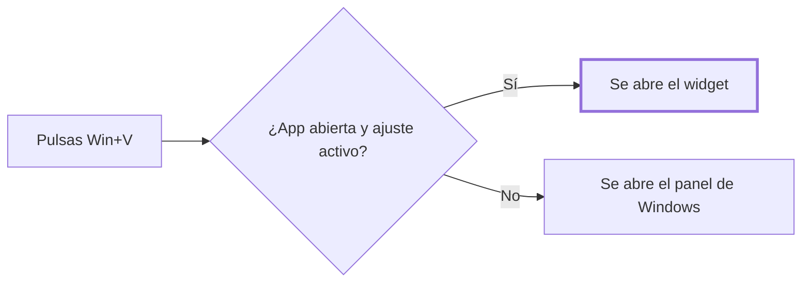

# CHG-001 · Win+V opcional para abrir el widget
**Estado:** Descartado
**Nivel:** S
**Modelo sugerido:** estandar
<!-- Estados y nivel se cambian SOLO con node .claude/team.mjs. Modelo: un perfil de docs/TEAM_MODELS.md -->
**Creado:** 2026-11-03 · **Aprobado:** 2026-11-03 · **Cerrado:** —
**Relacionado:** —

## 0. En palabras simples
<!-- Para el usuario: sin jerga. Si no se entiende en 30 segundos, reescríbelo. -->
- Qué vas a ver distinto: en Ajustes aparece la casilla "Usar Win+V para abrir el widget". Al marcarla, Win+V abre Clipboard Manager de inmediato, sin reiniciar nada. Al desmarcarla o cerrar la app, vuelve el panel de Windows. Ctrl+Alt+V sigue funcionando.
- Límite conocido: si la ventana activa corre como administrador, Win+V abre el panel de Windows, salvo que la app también corra como administrador.
- Cómo comprobarlo tú: marca la casilla y pulsa Win+V; debe abrirse el widget, sin el panel de Windows ni el menú Inicio. Desmárcala y pulsa Win+V; debe abrirse el panel de Windows.

## 1. Resumen
Hoy el widget se abre con Ctrl+Alt+V porque Windows reserva Win+V. Este cambio permite usar Win+V interceptándolo con un hook de teclado, como ajuste opcional y apagado por defecto. Se eligió frente a `DisabledHotkeys` porque, si la app se cierra, Win+V de Windows vuelve solo y no hay que tocar el registro.

## 4. Diseño técnico
- **Nuevo `src-tauri/src/winv.rs`:** hilo propio con bucle de mensajes (mismo patrón que `clipboard::listen`, `src-tauri/src/clipboard.rs:266`) y `SetWindowsHookExW(WH_KEYBOARD_LL)`.
- **Hook solo si el ajuste está activo:** se instala al activarlo y se retira al desactivarlo.
- **Decisión pura y testeable:** `should_capture(vk, win, ctrl, alt, shift)` solo acepta V con Win y sin otros modificadores. Win+Shift+V y demás combinaciones pasan intactas.
- **Al capturar:**
  - Consumir la V, incluido su keyup y las repeticiones.
  - Inyectar la tecla neutra `0xE8` para que soltar Win no abra el menú Inicio.
  - Abrir el widget una sola vez con `request_widget` (`src-tauri/src/main.rs:58`), que ya delega en otro hilo y no bloquea el hook.
- **Privacidad:** el hook no guarda ni registra ninguna tecla.
- **Ajuste:** añadir `win_v: bool`, por defecto `false`, a `Settings` (`src-tauri/src/db.rs:6`). `#[serde(default)]` ya cubre los ajustes antiguos.
- **Guardado y arranque:**
  - En `save_settings` (`src-tauri/src/main.rs:252`), aplicar el hook junto al manejo del atajo y revertirlo si falla el guardado.
  - En el arranque (`src-tauri/src/main.rs:668`), si falla, usar `startup_error` y mantener Ctrl+Alt+V.
- **Dependencias:** añadir la feature `Win32_UI_Input_KeyboardAndMouse` a `windows` en `src-tauri/Cargo.toml:28`.
- **UI:** casilla en "Historial y escritorio" y texto nuevo en lugar de "Win+V sigue perteneciendo a Windows" (`src/App.svelte:845`). Añadir `win_v` a los valores por defecto (`src/App.svelte:21` y `:32`).

## 5. Pruebas
Automáticas: `npm run native:test`, `npm run test:ui`, `npm run build`.

Manuales, en el build instalado:
- Ajuste apagado (por defecto): Win+V abre el panel de Windows.
- Ajuste activo: Win+V abre el widget, sin menú Inicio, con ambas teclas Win si el teclado las tiene.
- Mantener Win+V pulsado abre el widget una sola vez.
- Win solo abre Inicio; Win+Shift+V, Win+D y Ctrl+V funcionan igual; Ctrl+Alt+V sigue abriendo el widget.
- Desmarcar la casilla, cerrar la app o matar el proceso devuelve el panel de Windows.
- Con una ventana de administrador activa, ocurre lo documentado y el teclado sigue funcionando.
- El ajuste sigue activo tras reiniciar la app, incluido el inicio con Windows.
- Pegar desde el widget llega a la ventana donde se pulsó Win+V.
- Sin retraso perceptible al escribir con el ajuste activo.
- Windows Defender no bloquea el build instalado.

## 7. Tareas
<!-- Primero lo que cambia para el usuario; el detalle técnico después. Formato:
- [ ] T1 · qué cambia (en simple) — Resp: dev-implementer — Modelo: perfil — Archivos: … — Hecho cuando: … -->
- [x] T1 · Prueba inicial: Win+V abre el widget en lugar del panel de Windows, con el ajuste forzado en desarrollo. Si falla, parar y reevaluar antes de T2 — Resp: dev-implementer — Modelo: estandar — Archivos: src-tauri/src/winv.rs, src-tauri/src/main.rs, src-tauri/Cargo.toml — Hecho cuando: el usuario confirma en su equipo (build 26300) que no aparecen ni el panel de Windows ni el menú Inicio
- [x] T2 · Solo Win+V exacto abre el widget; las demás combinaciones siguen igual — Resp: dev-implementer — Modelo: estandar — Archivos: src-tauri/src/winv.rs — Hecho cuando: `npm run native:test` pasa y un test confirma que Win+Shift+V no se captura
- [x] T3 · El ajuste se guarda y se activa sin reiniciar la app — Resp: dev-implementer — Modelo: estandar — Archivos: src-tauri/src/db.rs, src-tauri/src/main.rs, src-tauri/src/winv.rs — Hecho cuando: el ajuste sobrevive a un reinicio, los ajustes antiguos cargan con `false` y un fallo al guardar revierte el hook
- [x] T4 · Casilla y textos nuevos en Ajustes — Resp: dev-implementer — Modelo: estandar — Archivos: src/App.svelte, src/types.ts, tests/ui.spec.ts — Hecho cuando: `npm run test:ui` cubre la casilla
- [ ] T5 · Actualizar documentación — Resp: tech-writer — Archivos: README.md — Hecho cuando: el README explica el ajuste y el límite con ventanas de administrador
- [ ] T6 · Verificar los casos manuales de §5 — Resp: qa-tester — Hecho cuando: todos pasan

## 8. Bitácora de implementación (dev-implementer)

- 2026-11-03 — Secuencia física vvv + Win+V confirmada por usuario y por el buscador de la instancia: probe=7 (callback, HC_ACTION y V), sin evento Win, coincidencia, inyección ni solicitud de widget. Usuario recuerda funcionamiento transitorio en una prueba anterior. Corrección candidata combinada: al llegar V se combinan modificadores observados por eventos con una instantánea de los otros modificadores; no se consulta el estado asíncrono de la propia V dentro del callback. Evita depender de que todas las transiciones Win lleguen al hook y conserva el rechazo conservador de Ctrl/Alt/Shift. Se añaden dos pruebas de transición Win ausente y modificadores adicionales muestreados: native:test → 46 pasan, 1 ignorada. Instrumentación temporal ampliada para distinguir Win muestreada, modificadores extra y repetición; permanece sin valores de texto ni historial de teclas. native:check y build debug sin bundle correctos; nueva instancia propia PID 27284, probe inicial 0, win_v=true y startup_error=null, con banner Reconocimiento combinado. Pendiente prueba manual del usuario. La causa de la omisión de Win aún no se atribuye a un programa concreto; no se cambiaron utilidades ni configuración del teclado.

- 2026-11-03 — Candidata 2 falla según usuario: Win+V sigue abriendo Windows. Snapshot posterior confirma win_v=true, startup_error=null y solo manager; desactivar/reactivar por IPC en el perfil temporal funciona sin error. Se incorpora instrumentación temporal de etapas en winv.rs y comando IPC win_v_probe en main.rs (solo flags volátiles, sin textos ni historial de teclas), que se retirará antes de entregar una corrección definitiva. Build debug y native:check correctos. Instancia de diagnóstico PID 23888 con datos temporales, captura desactivada y atajo alternativo Ctrl+Alt+Shift+F10; metadata en artifacts/winv-probe-session.json. La entrada neutra Shift enviada mediante computer-use produce probe=3: callback invocado y HC_ACTION recibido. F24 no fue admitida por el helper y no se envió. Se cerró la candidata 2 propia PID 27952; queda instancia diagnóstica con banner amarillo. Pendiente pulsación manual Win+V para localizar etapa exacta. La causa no se considera confirmada y no se genera otra afirmación de solución.

- 2026-11-03 — Candidata 2 compilada en release con npm run desktop:build; test:ui → 18 pasan y build web sin errores/advertencias Svelte. Instalador, firma y sha256.json en artifacts/builds/CHG-001-20261103-candidata-2/. verify-update confirma firma y rechazo de alteraciones/truncamiento. Se inicia ejecutable release para aceptación manual en identidad aislada con --data-dir temporal y --no-capture, preferencia win_v=true, captura pausada y atajo alternativo Ctrl+Alt+Shift+F11 para no competir con el instalado. PID 27952; metadata de sesión en artifacts/winv-candidate-session.json. Snapshot inicial confirma win_v=true y startup_error=null. Historial vacío; sin modificar instalación ni datos personales. Pendiente pulsación manual del usuario; CHG permanece En desarrollo y no se da por resuelto el fallo instalado.

- 2026-11-03 — Corrección candidata tras fallo instalado: usuario confirma que desactivar/guardar/reactivar/guardar tampoco recupera Win+V con la app activa. Se reemplazan consultas GetAsyncKeyState dentro del callback por estado efímero de modificadores actualizado con los eventos del hook (izquierda/derecha), sin guardar historial de teclas. La consulta asíncrona queda solo para inicialización fuera del callback. Se conserva el consumo de repeticiones/keyup y se evita capturar una V que ya estaba pulsada antes de formar la combinación. Si Windows rechaza SendInput para la tecla neutra, se informa mediante el canal de errores existente en lugar de fallar silenciosamente; la operación pesada de informar se delega fuera del callback. Cambios solo en winv.rs dentro del alcance aprobado. Cinco pruebas nuevas de secuencias: native:test → 44 pasan, 1 ignorada; rustfmt y diff --check correctos. Referencias revisadas: Microsoft LowLevelKeyboardProc y GetAsyncKeyState. Es una corrección de una fragilidad documentada; causa única y eficacia instalada aún sin confirmar. Se prepara candidata release para prueba manual aislada.

- 2026-11-03 — Por solicitud del usuario se compila el instalador local para actualizar manualmente su instalación. npm run desktop:build correcto (build web sin errores/advertencias Svelte, release Rust y NSIS x64). Se conserva la versión interna 0.2.4; instalación personal actual también 0.2.4, por lo que corresponde reinstalación manual. Artefactos en artifacts/builds/CHG-001-20261103-151104/: Clipboard-Manager_0.2.4_x64-setup.exe (5151211 bytes), firma .sig y sha256.json; hash de la copia coincide con el origen. Ejemplo verify-update confirma firma válida y rechazo de paquete alterado/truncado. No se ejecuta instalador ni se publica. CHG permanece En verificación con T5/T6 pendientes.

- 2026-11-03 — T4 completada: casilla Usar Win+V para abrir el widget en Historial y escritorio, valores iniciales false en settings/draft y contrato compartido Settings actualizado en src/types.ts con autorización. Texto explica aplicación al guardar sin reinicio, devolución del panel de Windows al desactivar/salir, continuidad del atajo configurable y límite con ventanas elevadas. Dos pruebas nuevas (claro/oscuro) en tests/ui.spec.ts verifican estado inicial, borrador sin efecto hasta guardar, descarte, guardado activado/desactivado, conservación al pausar captura, navegación, teclado y ausencia de desbordamiento en 760x600. Primer intento falló por selector de texto con espacio literal donde había salto de línea; se corrigió a whitespace flexible. Resultado final: npm run test:ui → 18 pasan; npm run native:test → 39 pasan, 1 ignorada; npm run build (pretest UI) sin errores/advertencias de Svelte; Prettier --check y git diff --check correctos. Revisión visual de artifacts/winv-settings-light.png y winv-settings-dark.png satisfactoria. Sin cambios en instalación personal, commits ni publicación. T1–T4 completan implementación; T5 README y T6 QA manual permanecen pendientes para sus responsables.

- 2026-11-03 — T3 completada en db.rs, main.rs y winv.rs (ampliación autorizada): preferencia win_v con false por defecto y compatibilidad serde; se retira la activación forzada de desarrollo. Control del hook mediante hilo y ventana de mensajes, confirmación síncrona de instalación/retirada, cambios idempotentes, reversión al estado real anterior si falla la persistencia y retirada al salir. El arranque respeta la preferencia, conserva el atajo configurado y acumula los errores sin ocultar el de Win+V. El guardado SQLite incluye ajustes y purga en una transacción; la limpieza de medios se ejecuta tras commit para no restaurar referencias a archivos borrados. Seis pruebas nuevas cubren reapertura de base, compatibilidad, activación/retirada simuladas, fallos de instalación/retirada/persistencia y error de reversión. Verificación: native:test → 39 pasan, 1 ignorada; test:ui → 16 pasan; build sin errores/advertencias Svelte; native:check, build debug sin bundle, rustfmt y diff --check correctos. Prueba nativa WebView2 con identidad/base temporal y captura desactivada: valor inicial false, activación/retirada/activación por IPC sin reinicio, preferencia true y startup_error vacío tras reinicio, y reversión ante triggers SQLite de fallo en ambas direcciones. Evidencia: artifacts/winv-t3.json. No se simularon pulsaciones; comprobaciones visuales completas y ventanas elevadas quedan para T6. Se cerró solo el prototipo T1 y las instancias aisladas de esta prueba; no se modificó la instalación ni datos personales. Casilla pendiente de T4.

- 2026-11-03 — T2 completada: la decisión pura de T1 ya restringía la captura a Win+V sin modificadores adicionales. Se añadieron tres pruebas en src-tauri/src/winv.rs: Win+V frente a V sola, Win+Shift+V y todas las combinaciones adicionales de Ctrl/Alt/Shift con o sin Win, y paso de las demás teclas virtuales (incluidos Win+D y Win solo). Sin cambios al comportamiento nativo ni a otros archivos de código. Verificación: npm run native:test → 33 pasan, 0 fallan, 1 ignorada por aislamiento; rustfmt --check del archivo y git diff --check correctos. Criterio automático de T2 cumplido; los casos manuales completos de §5 siguen reservados para T6.

- 2026-11-03 — T1 completada tras confirmación manual del usuario en build 26300. Sin cambios adicionales de código ni nuevas pruebas en esta confirmación; se conservan los resultados de la implementación registrados abajo. Pendiente autorización para continuar con T2.

- 2026-11-03 — Inicio de T1 en rama main; sin modificaciones previas de código, con archivos de equipo/docs sin seguimiento que se preservan. Línea base: `npm run native:test` → 30 pasan, 1 ignorada; `npm run test:ui` → 16 pasan y build previo sin errores ni advertencias de Svelte. Estado iniciado exclusivamente mediante `team.mjs start CHG-001`. La feature Windows de §4 forma parte del cambio aprobado.
- 2026-11-03 — T1 preparada, pendiente de aceptación manual: nuevo `src-tauri/src/winv.rs`, integración temporal bajo `debug_assertions` en `main.rs` y feature Windows aprobada en `Cargo.toml`. Hook en hilo de mensajes propio, consumo de V/repeticiones/keyup, tecla neutra 0xE8 y apertura mediante `request_widget`; sin registro de teclas. Si falla la inyección neutra, se deja pasar el atajo nativo. Sin preferencias persistidas ni casilla todavía. Verificación posterior: `npm run native:test` → 30 pasan, 1 ignorada; `scripts/native.ps1 check` correcto; `npx tauri build --debug --no-bundle` correcto, con `npm run build` sin errores/advertencias Svelte; rustfmt en archivos Rust afectados y `git diff --check` correctos. Ejecutable de prueba: `src-tauri/target/debug/clipboard-manager.exe`, iniciado con PID 18660 y argumentos `--data-dir <repo>/.tools/winv-t1 --no-capture --background`; sigue activo tras la comprobación inicial, sin usar la base ni credencial personales. Windows 11 build 26300 confirmado. T1 sigue sin marcar hasta que el usuario confirme ausencia del panel de Windows y de Inicio; no se avanzó a T2.

## 9. Preguntas abiertas, decisiones e historial
- 2026-11-03 — DESVIACIÓN técnica pendiente de aprobación: la comparación Win32 independiente finaliza con flags 523 en ambos hooks (recepción física de Win, sin V), y nuestra sonda con 11. El usuario reporta Windows también durante la prueba del agente Logitech; este ya está restaurado. La suposición de §4 de recibir V para consumirla no se cumple de forma fiable en estas pruebas. No se atribuye causa exacta al sistema ni a un programa. Evidencia, limitaciones y alternativas de revisión en DIAGNOSTICO.md. Se retiró la instrumentación temporal de main.rs/winv.rs y se cerraron instancias de prueba propias; utilidades restauradas. Pendiente decisión del usuario para cambiar punto de intercepción al prefijo Win o reconsiderar la liberación de reserva en Explorer; no se implementan estas variantes sin aprobación.
- 2026-11-03 — Reconocimiento combinado falla según usuario; probe=0 tras la combinación, por lo que ni siquiera se ejecutó el callback en esa secuencia. Prueba controlada: cierre temporal de procesos PowerToys bajo su directorio y guardas de restauración automática; usuario indica Windows sigue abriendo. PowerToys restaurado inmediatamente (PID 56476), sin editar preferencias. Paleta de comandos MSIX permaneció fuera del grupo cerrado; inspección acotada muestra UseLowLevelGlobalHotkey=false, CommandHotkeys vacío y activación Win+Alt+Space, sin atribuirle el fallo. Se crea sonda Win32 independiente temporal, dos hooks de paso (módulo nulo y módulo EXE), que solo guarda flags de recepción y origen, nunca texto ni historial; retira sus hooks automáticamente a los 180 segundos. Ambos hooks instalados correctamente, flags iniciales 0; evidencia artifacts/winv-native-baseline.json. Se reinicia nuestra instancia propia después de instalar la sonda para controlar el orden de registro: PID 51024, probe inicial 0 y banner Comparación Win32 independiente. Pendiente una pulsación manual comparativa; no se modifican más reglas de captura sin esa evidencia.
- 2026-11-03 — Usuario confirma teclado conectado directamente; se descarta como explicación de esta prueba el supuesto de un cliente remoto. PowerToys y Logitech Options+/G Hub activos. Lectura acotada de atajos de PowerToys no muestra Win+V exacto en AdvancedPaste/ShortcutGuide; ERGO K860 confirmado en Options+, sin Windows deshabilitada en su preferencia de teclas. No se cambian configuraciones ni se cierran estas utilidades. Se reinicia solo la instancia propia de diagnóstico (nuevo PID 6868), probe=0, banner indica escribir vvv en el buscador y luego Win+V. Pendiente comparación de entrada física normal frente a la sintética ya comprobada; no se atribuye todavía el fallo a PowerToys/Logitech.
- 2026-11-03 — Evidencia tras pulsación manual del usuario en diagnóstico: probe=3 (callback y HC_ACTION), sin eventos de Win ni V ni coincidencia de combinación; startup_error=null. Inmediatamente después, una V simple enviada por computer-use a la misma ventana cambia probe a 7, confirmando que el hook sigue recibiendo entradas y que el Win+V reportado no llegó a esta instancia. Se detectan Sunshine (sesión console 2) y servicio AnyDesk; esto no prueba una conexión activa. Se consulta al usuario si el teclado es local o remoto antes de concluir causa. Fuente primaria Moonlight: el mantenedor exige Capture system keyboard shortcuts para enviar Windows/atajos del sistema al host (github.com/moonlight-stream/moonlight-qt/issues/1219). Hipótesis de intercepción en cliente/remapeador pendiente de confirmación; no se cambia configuración remota.
- 2026-11-03 — QA del usuario falla en instalación: con casilla guardada, Win+V abre Windows. Se reabre mediante team.mjs reopen. Diagnóstico de solo lectura: una instancia instalada PID 51128; win_v=true y shortcut=Ctrl+Alt+V en preferencias; ventana de mensajes ClipboardManagerWinV pertenece a esa instancia; app, agente y Paseo en integridad media (8192); LowLevelHooksTimeout no personalizado. GetThreadDescription devolvió error, por lo que su ausencia de nombres NO permite inferir ausencia del hilo. Ejecutable instalado y empaquetado tienen igual tamaño y timestamps de esta compilación; diferencias de hash requieren tener presente el parche de tipo bundle de Tauri (no prueban binario antiguo). Prueba nativa previa cubrió ciclo de vida/IPC, sin pulsar Win+V; queda insuficiente para aceptación instalada. Pendiente prueba manual de desactivar/guardar/reactivar/guardar y Win+V con Clipboard Manager activo, para distinguir pérdida del hook de fallo permanente. No se alteraron ajustes ni procesos personales.
- 2026-11-03 — T4: el usuario autorizó continuar e incluir src/types.ts para alinear el contrato Settings compartido con la preferencia win_v del backend. Se actualiza la lista de archivos de T4.
- 2026-11-03 — Autorización del usuario: «Si, autorizo» incluir winv.rs en T3 para implementar ciclo de vida, activación/retirada y reversión. Se actualiza la lista de archivos de T3. La desviación anterior queda resuelta.
- 2026-11-03 — DESVIACIÓN T3: la tarea enumera solo db.rs y main.rs, pero winv::listen devuelve Result<(), String> y mantiene el hook en un hilo sin mecanismo de parada. Activar y retirar el hook sin reiniciar requiere ampliar T3 a src-tauri/src/winv.rs para controlar su ciclo de vida y confirmar retirada/errores. No se modificó código de T3; pendiente autorización del usuario para incluir ese archivo y sus pruebas de ciclo de vida/reversión.
- 2026-11-03 — T1 aceptada: ante la pregunta de si Win+V abrió únicamente el widget sin Windows/Inicio, el usuario confirmó: «Si, el widget abrió al pulsar Win+V». Se marca T1 completada con la evidencia manual y las verificaciones automáticas registradas en §8. El aviso del atajo configurado se mantiene como observación de la ejecución con dos instancias; no bloquea esta prueba de Win+V.
- 2026-11-03 — Captura del usuario muestra el widget de prueba con aviso de fallo al registrar el atajo configurado. Inspección confirma dos instancias: prototipo PID 18660 y aplicación instalada PID 42648 en `%LOCALAPPDATA%/Clipia/clipboard-manager.exe`. La colisión del atajo configurable entre instancias es la explicación probable; no se detuvo la aplicación personal ni se cambiaron sus ajustes. Pendiente confirmar si se abrió mediante Win+V y si Windows/Inicio permanecieron ocultos; T1 sigue sin completar.
- 2026-11-03 — Creado en to-do/ (Borrador, nivel S)
- 2026-11-03 — Decisión del usuario: hook de teclado opcional y apagado por defecto, en lugar de `DisabledHotkeys`.
- 2026-11-03 — §4 y §5 salen del plan aprobado por el usuario. Las skills software-architect y qa-tester no se pudieron invocar desde dev-team-lead (solo las ejecuta el usuario), así que no hubo revisión de esos roles.
- 2026-11-03 — Aprobado por el usuario (Compuerta 2)
- 2026-11-03 — Movido a in-progress/ (En desarrollo)
- 2026-11-03 — Implementación terminada → En verificación
- 2026-11-03 — Reabierto: QA instalada falla: Win+V abre Windows con win_v=true. Reproducir pulsación real en release y corregir dentro del hook aprobado.
- 2026-11-07 — Descartado: No funcionó el cambio (desde el panel)
